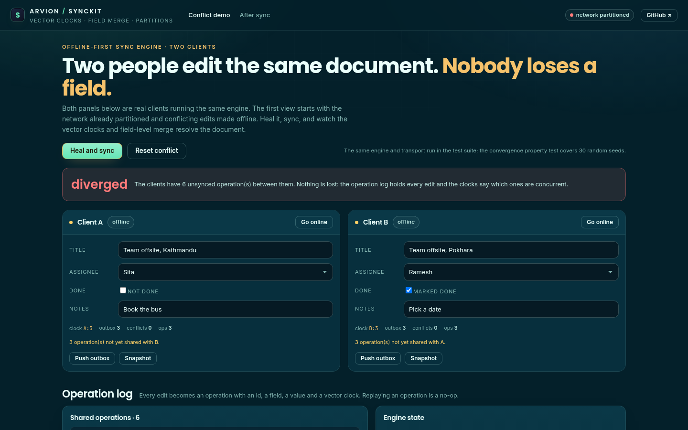
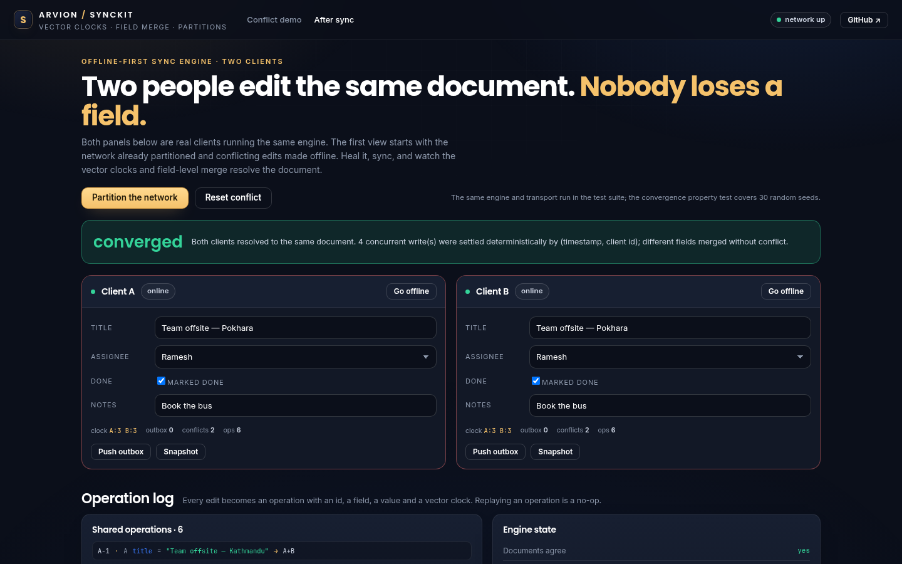

<div align="center">

</div>

<sub>Recorded from the live demo, <a href="docs/demo.mp4">MP4</a> · <a href="docs/screenshot.png">static frame</a></sub>

# SyncKit

An offline-first sync engine in plain JavaScript and Dart: an operation log,
vector clocks, last-writer-wins for a single field, field-level merge for
concurrent edits, and an in-memory transport with network partitions. The demo
runs two real clients side by side on the same document.

[**Open the live demo**](https://arvion-technology.github.io/labs/demos/sync-kit/) · [MIT](LICENSE)

---

Most "offline-first" examples are a queue that retries a POST. That works until
two devices edit the same record, or a field update lands before the operation
that created the record, or the app is killed with work pending. SyncKit is the
smaller, honest version of the problem: every mutation is an operation with a
vector clock, every client keeps an ordered log, and the merge rules are explicit
enough to test with random operation streams.

The demo starts with the network already partitioned and both clients editing the
same document. Heal it and the two panels converge, including the same-field
conflicts, which are resolved deterministically rather than "last message wins".

## What it does

- **Operation log**: every field edit becomes an operation with an id, client,
  field, value, logical timestamp and vector clock. Replaying one is a no-op.
- **Vector clocks**: increment, merge, and compare as equal, before, after or
  concurrent. Causality is computed, not inferred from wall time.
- **Two merge strategies**: last-writer-wins per field for same-field conflicts,
  and field-level merge so concurrent edits to different fields both survive.
- **A transport interface with partitions**: the in-memory bus queues operations
  during a partition and delivers them on heal. A WebSocket transport implements
  the same three methods.
- **Snapshot and compaction**: the log can be compacted into a snapshot without
  changing the document; restore puts the client back on that baseline.
- **A two-client demo**: edit either client, go offline, partition the network,
  heal, sync and watch the clocks, conflicts and operation flow.
- **A Dart port**: vector clocks and the LWW merge, tested against the same JSON
  vectors as the JavaScript engine.

## Screenshots

| Conflict before sync | Converged after sync |
| --- | --- |
|  |  |

## Architecture

```text
30-sync-kit/
├── src/
│   ├── clock.js       vector clock increment, merge, compare, missing-from
│   ├── engine.js      operation log, LWW + field merge, snapshot, syncPair
│   ├── transport.js   in-memory bus with partition/heal and a flow log
│   └── scenario.js    seeded random and conflict operation scripts
├── dart/
│   ├── synckit.dart   Dart port: clocks + per-field LWW document
│   └── synckit_test.dart
├── test/
│   ├── sync.test.js            17 node:test cases, including 30 random seeds
│   └── vectors/sync_vectors.json
├── demo/              two-client simulation and operation log
├── docs/              screenshots
└── scripts/           serve, shot, static checks
```

`src/` has no DOM and no browser APIs. The demo imports it directly, and the
tests import the same files.

## Quickstart

```bash
git clone https://github.com/arvion-technology/sync-kit.git
cd sync-kit
npm test                                  # 17 JavaScript cases
dart dart/synckit_test.dart               # 7 Dart cases against the same vectors
npm run demo                              # http://localhost:4173/demo/
```

Embed the engine in another app:

```js
import { createBus } from "./src/transport.js";
import { createClient, syncPair, converged } from "./src/engine.js";

const bus = createBus();
const a = createClient({ id: "A", transport: bus, doc: { title: "Plan" } });
const b = createClient({ id: "B", transport: bus, doc: { title: "Plan" } });

bus.partition();
a.set("title", "From A");
b.set("assignee", "Sita");
a.flush();
b.flush();
bus.heal();
syncPair(a, b);
console.log(converged(a, b)); // true, both fields survived
```

## How it works

**Causality is a vector clock, not a timestamp.** A clock is a map of client id to
counter. `increment` bumps the local client's counter; `mergeClocks` takes the
maximum of every entry. `compare` returns `equal`, `before`, `after` or
`concurrent`. Two edits are a real conflict only when their clocks are
concurrent; if one clock dominates, the older operation is stale and is ignored
without touching the document.

**Same-field conflicts resolve by (logical ts, client id).** Two concurrent edits
to `title` cannot both win. The engine keeps per-field metadata, the winning
timestamp, client and clock, and picks the higher timestamp, then the higher
client id, so every replica reaches the same value regardless of delivery order.
The losing edit is still in the log; nothing is deleted.

**Different fields merge by construction.** Every operation names one field. Two
concurrent operations on `title` and `assignee` are applied independently, which
is why field-level merge is the default and the conflict counter only moves for
same-field concurrency.

**Partitions live in the transport, not the engine.** `createBus()` queues posts
per recipient while `partition()` is active and delivers them on `heal()`. The
engine keeps pushing operations into its outbox; whether they travel now or later
is the transport's problem. This is also why the demo's per-client "offline"
switch and the network partition are separate controls: both are real failure
modes.

**Snapshots compact without changing state.** `compact()` captures the document,
field metadata and clock, and replaces the log with one snapshot entry.
`restore()` loads that baseline. Operations still carry their clocks, so a client
that restores can still receive later operations correctly.

**Convergence is tested as a property, not an example.** For 30 seeds, the test
generates an operation stream across two clients, applies it while partitioned,
heals, exchanges operations, and asserts the documents and clocks are equal. A
second test replays a full log and asserts the document does not change. That is
the check that catches an ordering bug the hand-written cases miss.

## Tests

```bash
npm test                          # 17 JavaScript cases
dart dart/synckit_test.dart       # 7 Dart cases, same vectors
```

The JavaScript suite covers clock increment/merge/compare symmetry, missing
operations, the transport queue and heal, local operations, duplicate
idempotency, stale rejection, same-field and different-field concurrency, two-way
sync, snapshot/compact/restore, deterministic replay and the random convergence
property. The Dart test reads `test/vectors/sync_vectors.json`, the same
comparison, merge and apply cases, so the port cannot silently diverge.

## Limitations

- The merge is last-writer-wins per field, not a CRDT for rich text or lists.
  Concurrent edits to the same field lose one value by design; the operation log
  keeps it, but there is no automatic merge UI.
- The transport is in-memory. There is no WebSocket adapter, auth, retry policy or
  persistence of the queued operations across a process kill in this sample.
- The engine assumes a trusted client id. A production system needs authenticated
  client identities and a server that enforces the same merge rules.
- Tombstones and deletion are not modelled. `done: false` is a value; a deleted
  field would need its own operation type.
- Snapshots are per-client. There is no server-side compaction or snapshot
  exchange protocol.

## Project layout

```text
30-sync-kit/
├── src/
│   ├── clock.js       vector clocks
│   ├── engine.js      op log, merge rules, snapshots
│   ├── transport.js   in-memory partitioned bus
│   └── scenario.js    seeded operation streams
├── dart/              Dart port + its test
├── test/              node:test suite and shared vectors
├── demo/              two-client simulation
├── docs/              screenshots
└── scripts/           serve, shot, static checks
```

## Credits

Built by [Arvion Technologies](https://arviontech.net) in Kathmandu. The engine
grew out of the offline queue in our home-services app, where ordered retries
were enough; this repository is the version for documents, where two people can
genuinely edit at once. MIT licensed.
